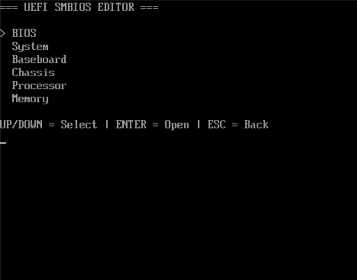
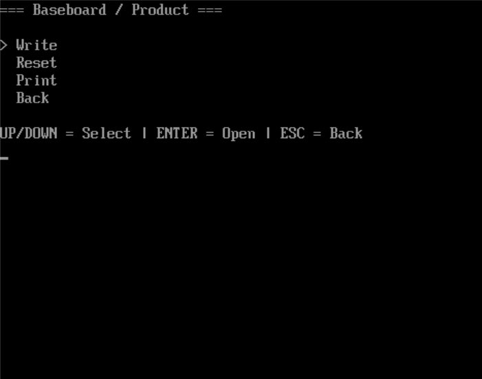

# UEFI SMBIOS Editor

A simple UEFI application for viewing and editing SMBIOS information, built with EDK II.

## Screenshots

<table>
  <tr>
    <th align="center">Main Menu</th>
    <th align="center">Editor</th>
  </tr>
  <tr>
    <td></td>
    <td></td>
  </tr>
</table>

## Features

- Keyboard-driven menu for BIOS, System, Baseboard, Chassis, Processor, and Memory
- View, write, and reset supported SMBIOS string fields
- Dynamic support for multiple memory devices (SMBIOS Type 17)
- Store overrides in UEFI NVRAM and reapply them with `/apply`

## Build and Run

Developed and tested using EDK II, QEMU, and OVMF.

1. Set up EDK II, QEMU, and the required Visual Studio build tools.
2. Check the paths in `scripts/build.bat` and `scripts/run.bat`.
3. Run `scripts/build.bat` to build `smeditor.efi`.
4. Run `scripts/run.bat` to launch QEMU with OVMF.
5. In the UEFI Shell, run `smeditor.efi` to open the menu.

Use the arrow keys to navigate, **Enter** to select, and **Esc** to go back.

The QEMU startup script runs `smeditor.efi /apply` to reapply saved overrides during boot.

## Notes

- SMBIOS changes affect the current UEFI session; the tool does not flash or rewrite BIOS firmware.
- Overrides are saved in UEFI NVRAM and must be reapplied after a reboot.
- Reset removes a saved override; the original firmware value is restored on the next boot.
- Tested in QEMU/OVMF. Physical motherboard compatibility has not been verified.
